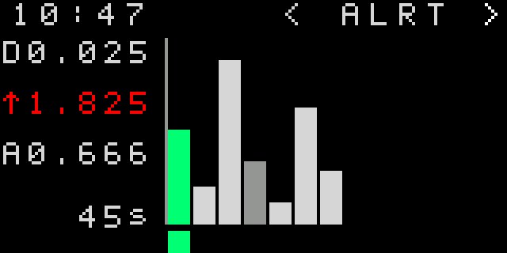

# Geiger-2 — короткий посібник користувача (чернетка)

> Це попередній посібник для поточної прошивки. Значення на SVG — приклади, а не показники конкретного приладу. Фізичне калібрування дозиметра ще не підтверджене вимірюваннями.

## Навігація

- На екрані рівня коротке натискання правої кнопки перемикає рівень і дозу.
- Довге натискання правої відкриває додаткові екрани. Короткими натисканнями лівої/правої кнопки переходьте між доступними сторінками. Довге ліве повертає на попередній головний екран.
- На екрані рівня коротка ліва змінює режим індикації. Довга ліва вмикає або вимикає ліхтарик.
- На екрані дози коротка ліва так само змінює режим індикації, а довга ліва керує ліхтариком.

## 1. Рівень

Показує поточний рівень випромінювання великими цифрами. Верхній рядок містить час, сонячний вхід і заряд батареї. Нижній рядок може показувати CPM або CNT-прогрес під час початкового набору імпульсів.

### Варіанти екрана

- [1.0.1 — рівень µSv/h із CNT-прогресом та індикаторами S/L](renders/screens/1.0.1-rate-blue-cnt.svg)
- [1.0.2 — зелений рівень і CPM](renders/screens/1.0.2-rate-green-cpm.svg)

### 1.1. Налаштування

У SETTINGS довге праве активує список і вибирає перший видимий пункт. Короткі ліве/праве переміщують курсор. Для пункту з трьома або менше варіантами довге праве одразу змінює значення. Для LOG MEMORY та пунктів із більш ніж трьома варіантами відкривається окремий екран зі значеннями у двох стовпчиках. Короткі кліки рухають вибір згори вниз, спочатку в лівому, потім у правому стовпчику; довге праве зберігає, довге ліве скасовує редагування.

- [1.1.1 — вибраний пункт DOSE PERIOD](renders/screens/1.2.1-settings-simple.svg)
- [1.1.2 — вибір LED BRIGHT](renders/screens/1.2.2-settings-many-options.svg)
- [1.1.3 — нижні пункти меню з увімкненими прихованими пунктами](renders/screens/1.2.3-settings-actions.svg)

## 2. Доза

Показує накопичену дозу. Період і одиниці задаються в SETTINGS; другий рядок може показувати час, іншу одиницю, інший період або CPM.

### 2.1. Графік рівня за 90 секунд

Довге праве на екрані дози відкриває графіки. Короткими ліве/праве перемикайте режими; у SEC довге праве циклічно змінює інтервал 10/30/60/90 секунд. У SEC показані поточний, максимальний, середній і мінімальний рейт. У журналах ліворуч показані доза, MAX, AVG і тривалість покриття.

### 2.2. Денний графік

Денний графік показує до 50 записів, до 13 стовпчиків одночасно. Найновіший запис із тимчасового буфера стоїть першим; далі йдуть записи з пам’яті. Стовпчики мають ширину 7 пікселів із проміжком 1 піксель. Вибраний стовпчик виділено акцентним кольором. За його вибору дата з’являється згори, а зліва відображаються доза, MAX, AVG і тривалість запису в налаштованих одиницях. Без вибраного стовпчика показується зведення за всі доступні дні. Дані на зображенні умовні.

### 2.3. Алерти

ALRT показує записи перевищень у вигляді стовпчиків. Найновіший запис стоїть першим, вибраний стовпчик зелений. Зліва показані доза, максимум, середнє та тривалість; MAX забарвлений за рівнем небезпеки. Значення на зображенні умовні.

Вкладка Logs вебзастосунку показує хвилинні, погодинні, денні й тривожні записи, якщо відповідний журнал доступний. Для вимірювань відображаються дата, доза, середній і максимальний рейт та заповненість інтервалу.

## Межі чернетки

SVG показують розкладку й шрифти прошивки; час, відсотки та історичні значення в них демонстраційні. Функції меню й поведінку кнопок описано за поточним кодом. Точність показів, пороги калібрування та роботу RTC після повного знеструмлення треба підтвердити на пристрої.

