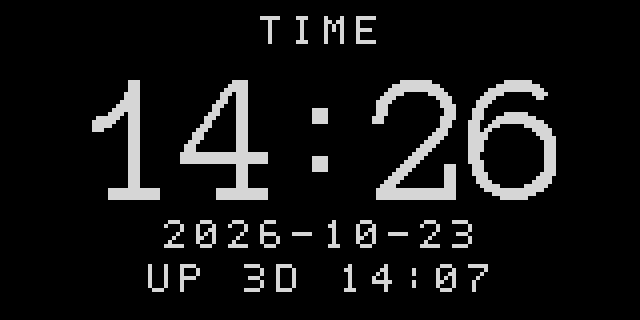
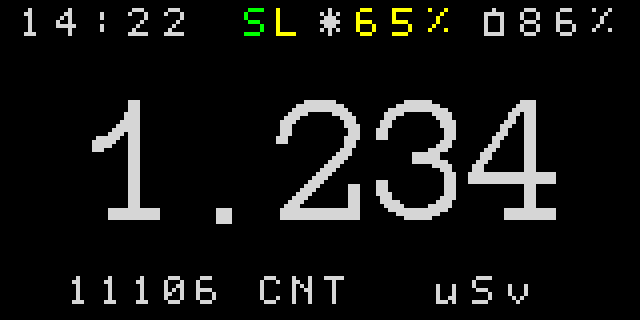
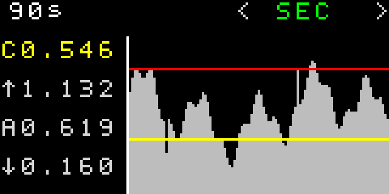
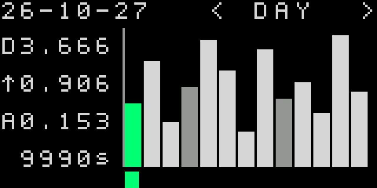

# Geiger-2 — короткий посібник користувача (чернетка)

> Це попередній посібник для поточної прошивки. Значення на SVG — приклади, а не показники конкретного приладу. Фізичне калібрування дозиметра ще не підтверджене вимірюваннями.

## Навігація

- На екрані рівня коротке натискання правої кнопки перемикає рівень і дозу.
- Довге натискання правої відкриває додаткові екрани. Короткими натисканнями лівої/правої кнопки перемикайте час, налаштування та діагностику. Довге ліве повертає на попередній головний екран.
- На екрані рівня коротка ліва змінює режим індикації. Довга ліва вмикає або вимикає ліхтарик.
- На екрані дози коротка ліва тимчасово ховає або показує додатковий рядок, якщо він налаштований.

## 1. Рівень

Показує поточний рівень випромінювання великими цифрами. Верхній рядок містить час, сонячний вхід і заряд батареї. Нижній рядок може показувати CPM або CNT-прогрес під час початкового набору імпульсів.

### Варіанти екрана

- [1.0.1 — рівень із CNT-прогресом](renders/screens/1.0.1-rate-blue-cnt.svg)
- [1.0.2 — зелений рівень і CPM](renders/screens/1.0.2-rate-green-cpm.svg)

### 1.1. Час

Екран показує великий час, дату та тривалість роботи пристрою. Щоб змінити календар, відкрийте TIME довгим натисканням правої кнопки. Короткими натисканнями виберіть поле; довге праве починає редагування. Короткі ліве/праве змінюють значення, довге праве підтверджує поле. На SAVE довге праве записує час.

### 1.2. Налаштування

У SETTINGS короткі ліве/праве переміщують курсор. Довге праве активує список. Для пункту з трьома або менше варіантами довге праве одразу змінює значення. Для пункту з більш ніж трьома варіантами довге праве переводить вибір із назви до значення; короткі кліки змінюють його, довге праве зберігає, довге ліве скасовує редагування.

- [1.2.1 — простий перемикач USE-SPI](renders/screens/1.2.1-settings-simple.svg)
- [1.2.2 — яскравість LED із дев’ятьма варіантами](renders/screens/1.2.2-settings-many-options.svg)

## 2. Доза

Показує накопичену дозу. Період і одиниці задаються в SETTINGS; другий рядок може показувати час або додаткову статистику.

### 2.1. Графік рівня за 90 секунд

Довге праве на екрані дози відкриває графіки. Короткими ліве/праве перемикайте режими; у SEC довге праве циклічно змінює інтервал 10/30/60/90 секунд. На графіку показані поточне, максимальне, середнє й мінімальне значення.

### 2.2. Денний графік

Кожен стовпчик відповідає денному запису. Довге праве вмикає курсор; короткі ліве/праве переміщують його між записами. Дата вибраного дня з’являється у верхньому лівому куті, а панель статистики показує дані цього дня. Повторне довге праве вимикає курсор; довге ліве повертає до вибору графіка.

## Межі чернетки

SVG показують розкладку й шрифти прошивки; час, відсотки та історичні значення в них демонстраційні. Функції меню й поведінку кнопок описано за поточним кодом. Точність показів, пороги калібрування та роботу RTC після повного знеструмлення треба підтвердити на пристрої.

