# Geiger-2 — короткий посібник користувача (чернетка)

> Це попередній посібник для поточної прошивки. Значення на SVG — приклади, а не показники конкретного приладу. Фізичне калібрування дозиметра ще не підтверджене вимірюваннями.

## Навігація

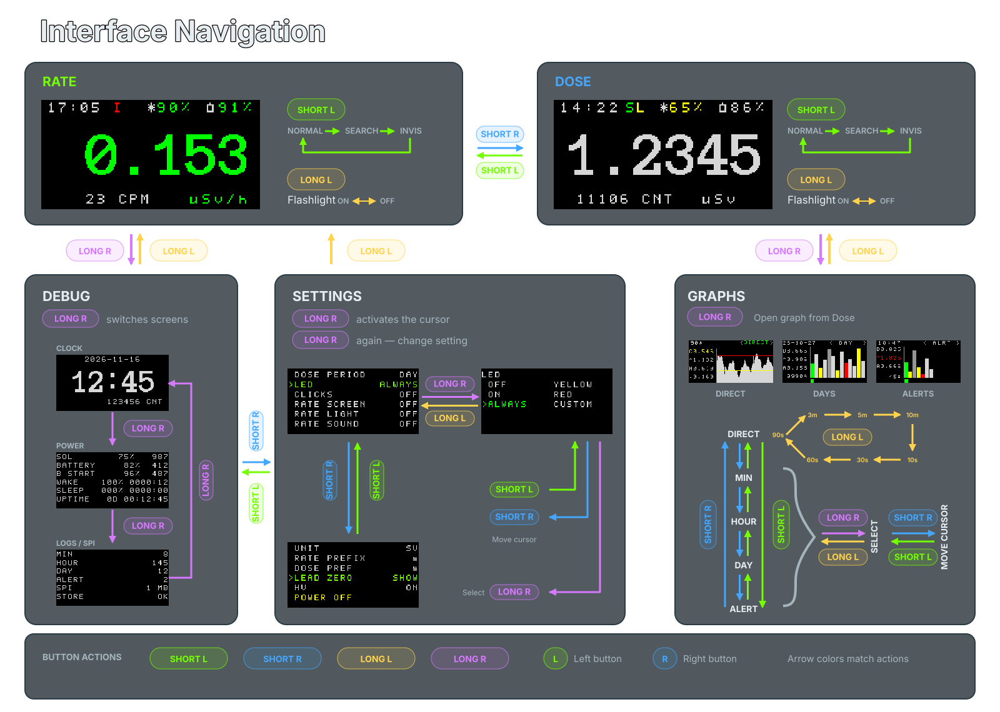

- На екрані рівня коротке натискання правої кнопки перемикає рівень і дозу.
- Довге натискання правої відкриває додаткові екрани. Короткими натисканнями лівої/правої кнопки переходьте між доступними сторінками. Довге ліве повертає на попередній головний екран.
- На екрані рівня коротка ліва змінює режим індикації. Довга ліва вмикає або вимикає ліхтарик.
- На екрані дози коротка ліва так само змінює режим індикації, а довга ліва керує ліхтариком.

### Вебзастосунок на Android

Для підключення дозиметра через USB відкрийте вебзастосунок у Chrome, під’єднайте адаптер CP210x і натисніть **Connect USB**. Firefox для Android не підтримує потрібне USB API; кнопка **Open in Chrome** відкриває цю сторінку в Chrome. У Firefox кнопка встановлення прихована, оскільки створений там ярлик знову запускав би сторінку у Firefox. На комп’ютері використовуйте браузер із підтримкою Web Serial.

### Оцінка заряду батареї

Відсоток оцінюється за показанням ADC, а не окремим лічильником заряду. Без виявленого USB або сильного сонячного входу відображуване значення може лише знижуватися; за наявності одного з цих джерел воно може зрости. Це ознаки можливого живлення, а не вимір зарядного струму. Точність і пороги треба перевірити на пристрої.

## 1.0. Рівень

Показує поточний рівень випромінювання великими цифрами. Верхній рядок містить час, сонячний вхід і заряд батареї. Параметр RATE ACCURACY задає цільову статистичну похибку 30%, 25%, 20%, 15%, 10% або 5% (приблизно 12, 16, 25, 45, 100 або 400 імпульсів). **Швидше ↔ точніше:** 30% дає швидшу реакцію за меншої кількості імпульсів; наближення до 5% дає точнішу та стабільнішу оцінку, але потребує більше імпульсів і часу за того самого рівня випромінювання. До досягнення вибраної кількості великий рейт і похибка сині; після досягнення похибка стає сірою. На пристрої оцінка тимчасово замінює другий рядок, а після досягнення цілі повертається RATE ROW 2, якщо там не вибрано ACCURACY. Додаток постійно показує CNT і оцінку похибки від моменту ввімкнення HV. До першого імпульсу похибка позначається INF, мінімальне значення похибки — 5%. Оцінка рейту починається поблизу 23 CPM і уточнюється за ковзною вибіркою імпульсів. Кожен імпульс одразу враховується в дозі та журналах. Після паузи в імпульсах понад хвилину відлік вибірки починається заново, а рейт спадає до нуля. Великі цифри використовують Anonymous Pro Bold. У пошуковому режимі значення оновлюється кожні 100 мс, реагує на імпульси й плавно спадає між ними; на екрані займає не більше шести символів разом із десятковою крапкою.

Оновлення оцінки рівня має пріоритет зверху вниз; застосовується перша відповідна умова:

| Умова | Інтервал |
|---|---:|
| SEARCH або активна передача даних | 100 мс |
| Екран увімкнений | 1 с |
| Екран вимкнений | за кожним імпульсом |

Передача даних визначається активністю протоколу, а не самим підключенням USB чи заряджанням. Під час SEARCH і передачі зберігається фіксований крок 100 мс. Коли екран вимкнений, нове значення оновлюється лише після імпульсу. Згладжування враховує час між оновленнями.

У пошуковому режимі на великому екрані показується не більше шести символів разом із десятковою крапкою. Імпульси рахуються одразу; вимірювання, журнали й перевірка сигналізації зберігають секундний крок. Виміряний CPM для журналів і сигналізації не згладжується цим фільтром. Підключений додаток запитує статус кожні 100 мс; історія графіка зберігає секундний масштаб із накопиченням усіх імпульсів у поточній точці.

### Варіанти екрана

<table width="100%"><tr>
<td width="33%"><strong>1.0.1 — синій рейт і похибка</strong> 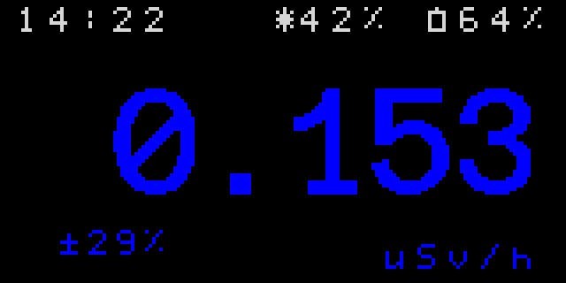</td>
<td width="33%"><strong>1.0.2 — зелений рейт і CPM</strong> 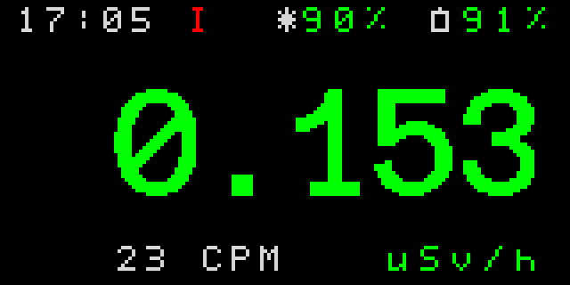</td>
<td width="33%"></td>
</tr></table>

### 1.1. Debug

Debug має три сторінки: час, дату й загальний лічильник імпульсів; показання живлення та тривалість WAKE/SLEEP/UPTIME; кількість записів MIN/HOUR/DAY/ALERT, обсяг SPI й стан сховища. Довге праве перемикає сторінки Debug.

<table width="100%"><tr>
<td width="33%"><strong>1.1.1 — годинник Debug</strong> 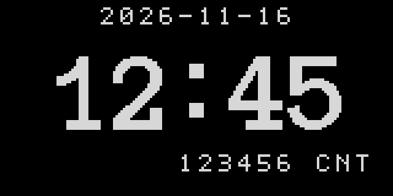</td>
<td width="33%"><strong>1.1.2 — живлення Debug</strong> 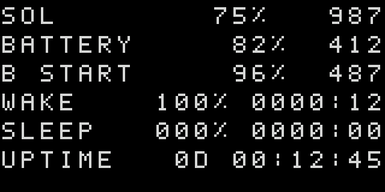</td>
<td width="33%"><strong>1.1.3 — логи та SPI Debug</strong> 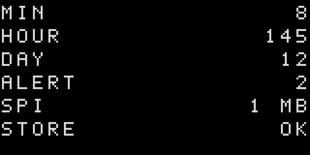</td>
</tr></table>

### 1.2. Налаштування

У SETTINGS довге праве активує список і вибирає перший видимий пункт. Короткі ліве/праве переміщують курсор. Для пункту з трьома або менше варіантами довге праве одразу змінює значення. Для LOG MEMORY та пунктів із більш ніж трьома варіантами відкривається окремий екран зі значеннями у двох стовпчиках. Короткі кліки рухають вибір згори вниз, спочатку в лівому, потім у правому стовпчику; довге праве зберігає, довге ліве скасовує редагування.

Основні пункти меню:

| Пункт | Призначення |
|---|---|
| DOSE PERIOD | UPTIME — від запуску; DAY — за поточну календарну добу; TOTAL — збережена сумарна доза. |
| RATE ACCURACY | Ціль похибки 30%, 25%, 20%, 15%, 10% або 5% — приблизно 12, 16, 25, 45, 100 або 400 імпульсів. **Швидше ↔ точніше:** 30% — швидша реакція; 5% — точніша, стабільніша оцінка, що потребує більше імпульсів і часу за того самого рівня випромінювання. До цілі похибка синя, після — сіра. Вона тимчасово замінює другий рядок, якщо RATE ROW 2 не встановлено в ACCURACY. |
| LED / CLICKS | Індикація імпульсів: OFF, ON, ALWAYS або за рівнями YELLOW, RED, CUSTOM. |
| RATE/DOSE SCREEN, LIGHT, SOUND | Незалежні дії для рейту та дози: OFF, YELLOW, RED або CUSTOM. RATE CUSTOM і DOSE CUSTOM задають відповідні власні пороги. |
| RATE ROW 2 / DOSE ROW 2 | Вибір додаткової інформації під основним значенням, включно з одиницями, періодом, CNT/CPM/CPS, часом, ACCURACY або OFF; недоступні дублікати поточного значення вимкнені. |
| LED TIME / LED BRIGHT | Тривалість імпульсу й ШІМ-яскравість світлодіода; AUTO залежить від сонячного входу. |
| SCREEN BRIGHT / SCREEN TIMER | Яскравість екрана (AUTO або фіксовані рівні) та час до вимкнення. |
| UNIT / RATE PREFIX / DOSE PREFIX / BATT FORMAT / LEAD ZERO | Одиниці Sv, CNT або R, префікси, формат батареї (% / V / RAW) і показ нуля перед дробовою частиною. |
| HV | OFF вимикає детектор, призупиняє дозу й постійні журнали, а відображуваний рейт спадає. Після паузи без імпульсів понад хвилину вибірка рейту починається заново після ввімкнення HV. |
| LOG MEMORY / RESET / TONE / LONG PRESS | Вибір EEPROM/SPI або вимкнення запису, очищення даних, тембр звуку та тривалість довгого натискання. POWER OFF вимикає прилад, REBOOT перезапускає його. Деякі пункти приховані за замовчуванням; їхню видимість можна змінити в додатку. |

<table width="100%"><tr>
<td width="33%"><strong>1.2.1 — вибраний LED</strong> 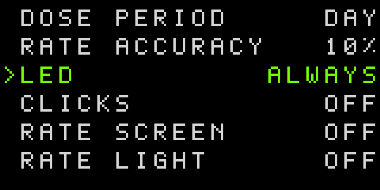</td>
<td width="33%"><strong>1.2.2 — опції LED</strong> 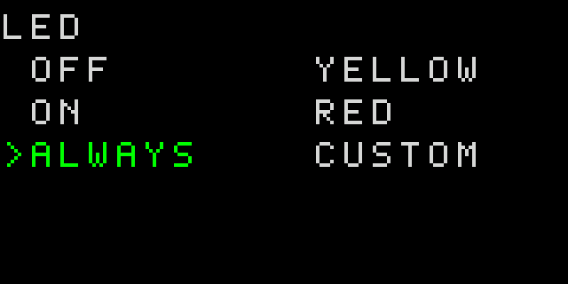</td>
<td width="33%"><strong>1.2.3 — нижні налаштування</strong> 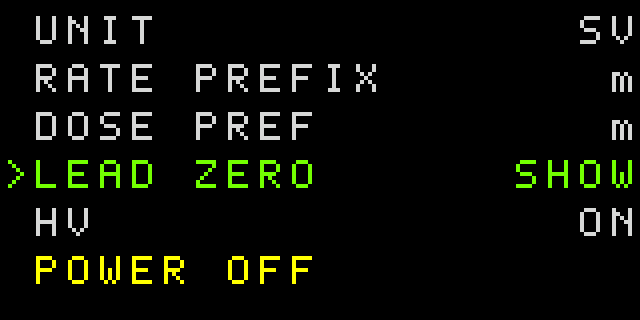</td>
</tr></table>

## 2. Доза

Показує накопичену дозу. Період і одиниці задаються в SETTINGS; другий рядок може показувати час, іншу одиницю, інший період або CPM.

Доза в хвилинному журналі має більшу статистичну невизначеність через короткий інтервал і малу кількість імпульсів. Годинна й денна дози підсумовують фактичні імпульси складових записів, а не усереднюють округлені хвилинні дози; довший інтервал зменшує статистичні коливання. Абсолютна точність дози все одно залежить від калібрування лічильникової трубки.

<table width="100%"><tr><td width="33%"><strong>Екран дози</strong> 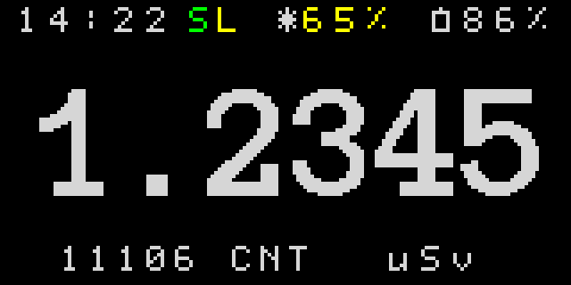</td><td width="33%"></td><td width="33%"></td></tr></table>

### 2.1. Графіки

Довге праве на екрані дози відкриває графіки. Короткими ліве/праве перемикайте режими DIRECT, MINUTE, HOUR, DAY і ALERT; у DIRECT довге праве циклічно змінює інтервал 10/30/60/90 секунд, 3/5/10 хвилин і повертається до 10 секунд. У DIRECT показані поточний, максимальний, середній і мінімальний рейт. У вебзастосунку графік містить до 1000 секунд історії, масштабується колесом миші або жестом двома пальцями на сенсорному екрані та прокручується перетягуванням або колесом із затиснутим Shift чи Alt. Під час масштабування точка під центром жесту залишається на місці. Внутрішній фрагмент історії не зсувається під час надходження нових вимірювань. Маркери спрацювань відповідають фактичним CNT, а підказка показує значення, CNT і час точки. Під графіком показано дози, CNT, MIN/AVG/MAX та кількість секунд видимого фрагмента. У журналах ліворуч показані доза, MAX, AVG і тривалість покриття.

<table width="100%"><tr><td width="33%"><strong>DIRECT</strong> 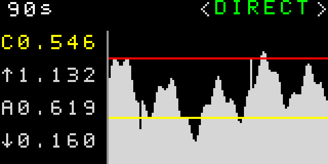</td><td width="33%"></td><td width="33%"></td></tr></table>

### 2.2. Денний графік

Денний графік показує до 50 записів, до 13 стовпчиків одночасно. Найновіший поточний запис білий; стовпчики забарвлені за кольором дози (білий, жовтий або червоний). Усі неповні стовпчики, включно з поточним, затемнюються. Поруч числові значення швидкості мають зелений, жовтий або червоний колір; значення дози — білий, жовтий або червоний. Вибраний стовпець і курсор під ним зелені. За його вибору дата з’являється згори, а зліва відображаються доза, MAX, AVG і тривалість запису в налаштованих одиницях. Без вибраного стовпчика показується зведення за всі доступні дні. Дані на зображенні умовні.

<table width="100%"><tr><td width="33%"><strong>DAY</strong> 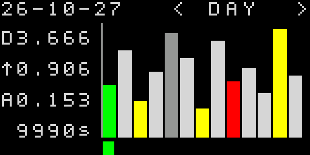</td><td width="33%"></td><td width="33%"></td></tr></table>

### 2.3. Алерти

ALERT показує записи перевищень у вигляді стовпчиків зеленого, жовтого або червоного кольору відповідно до максимального рівня. Усі неповні стовпчики затемнюються. Вибраний стовпець і курсор під ним зелені. Зліва показані доза, максимум, середнє та тривалість; рейтові значення забарвлюються зелено-жовто-червоним. Значення на зображенні умовні.

<table width="100%"><tr><td width="33%"><strong>ALERT</strong> 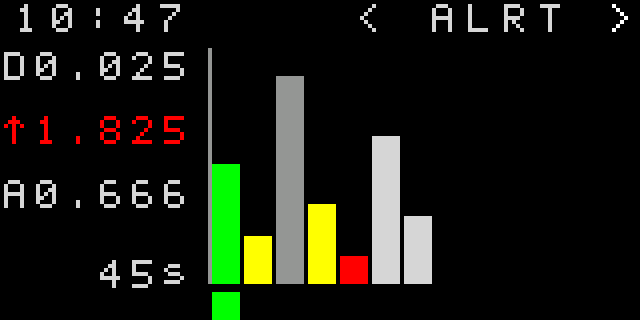</td><td width="33%"></td><td width="33%"></td></tr></table>

У графіку вебзастосунку під графічною областю показані DOSE, CNT, MIN, AVG, MAX і кількість секунд видимого фрагмента; під час переміщення або масштабування підсумки оновлюються. У налаштуваннях додатку час пристрою можна синхронізувати з локальним часом комп’ютера. Після підключення або синхронізації підказка “Waiting to stabilize…” показує, що оцінка різниці ще стабілізується. Розгорніть картки RATE і DOSE на Overview, щоб переглянути додаткові одиниці та періоди. Вкладка Logs вебзастосунку показує хвилинні, погодинні, денні й тривожні записи, якщо відповідний журнал доступний. Для вимірювань відображаються дата, доза, середній і максимальний рейт та заповненість інтервалу. AVG обчислюється за кількістю імпульсів і фактичним часом покриття. MAX починається з поточного обчисленого рейту першого семплу; далі він оновлюється лише вгору. Погодинний MAX — найбільший хвилинний MAX, денний — найбільший погодинний MAX. Значення рейту позначаються зеленим, жовтим або червоним, а дози — білим, жовтим або червоним. Стрілка в кінці рядка відкриває хвилинні записи для години, годинні записи для дня або хвилину, в якій почався алерт; перехід доступний для записів із календарною датою. Кнопка More продовжує перерване завантаження та перегортає годинний, денний, місячний або довільний календарний діапазон назад на такий самий період.

### Імпорт, експорт і перегляд журналів у додатку

Таблиця журналу підлаштовується під ширину сторінки без окремого горизонтального прокручування. Під час прокручування сторінки заголовок колонок і рядок TOTAL залишаються закріпленими зверху. У повноекранному режимі журнал прокручується всередині власної області.

Коли пристрій не підключено, у Logs можна імпортувати CSV, раніше експортований цим додатком, або повний BIN-дамп журналів: EEPROM розміром 2 КіБ чи SPI розміром 1 МіБ. Імпорт CSV об’єднує записи з наявним офлайн-архівом; імпорт BIN замінює поточний архів. Після імпорту записи всіх наявних типів можна переглядати, фільтрувати й експортувати без підключення до приладу.

Export зберігає записи поточного типу, які вже завантажені. Export All об’єднує завантажені записи різних типів в один CSV і не дозавантажує відсутні дані; типи без завантажених записів пропускаються.

Якщо завантажено понад 100 записів, журнал розбивається на сторінки. Rows задає кількість рядків на сторінці: 1 000 за замовченням, або 10, 30, 50, 100, 500, 5 000 чи All. Пагінація змінює лише відображення; Export і Export All зберігають завантажені записи. More окремо дозавантажує старіші записи з приладу.

Під час оновлення журнал зберігає вибране сортування. Коли починається новий період, додаток повторно читає попередній поточний запис із приладу й оновлює його фінальними значеннями, навіть якщо запис розташований на іншій сторінці.

### Портал версій

Портал має розділи RELEASES, PRE-RELEASES і OLDER PRE-RELEASES. Спочатку показуються три найновіші стабільні релізи та перший пре-реліз, опублікований після останнього стабільного релізу. Для решти стабільної історії є окремий Show more. Спільна кнопка Show more для пре-релізів розкриває решту новіших пре-релізів і весь розділ старих пре-релізів разом із заголовком. Порожні розділи приховані; PRE-RELEASES також не показується, коли новіших пре-релізів немає.

## Межі чернетки

SVG показують розкладку й шрифти прошивки; час, відсотки та історичні значення в них демонстраційні. Функції меню й поведінку кнопок описано за поточним кодом. Точність показів, пороги калібрування та роботу RTC після повного знеструмлення треба підтвердити на пристрої.

Відсоток батареї залишається оцінкою за напругою. Виявлення USB і сонячного входу не підтверджує наявність зарядного струму; нову поведінку треба перевірити на пристрої.

