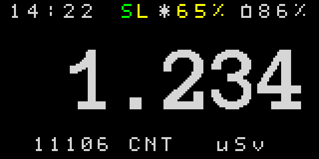
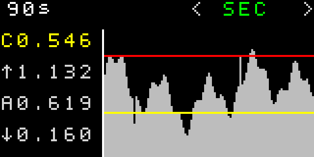
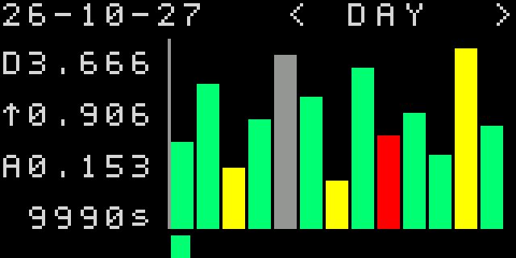
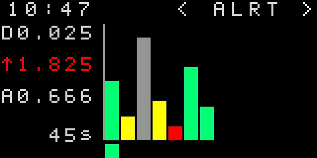

# Geiger-2 — короткий посібник користувача (чернетка)

> Це попередній посібник для поточної прошивки. Значення на SVG — приклади, а не показники конкретного приладу. Фізичне калібрування дозиметра ще не підтверджене вимірюваннями.

## Навігація

- На екрані рівня коротке натискання правої кнопки перемикає рівень і дозу.
- Довге натискання правої відкриває додаткові екрани. Короткими натисканнями лівої/правої кнопки переходьте між доступними сторінками. Довге ліве повертає на попередній головний екран.
- На екрані рівня коротка ліва змінює режим індикації. Довга ліва вмикає або вимикає ліхтарик.
- На екрані дози коротка ліва так само змінює режим індикації, а довга ліва керує ліхтариком.

## 1. Рівень

Показує поточний рівень випромінювання великими цифрами. Верхній рядок містить час, сонячний вхід і заряд батареї. Нижній рядок може показувати CPM або CNT-прогрес під час початкового набору імпульсів.

### Варіанти екрана

- [1.0.1 — рівень µSv/h із CNT-прогресом та індикаторами S/L](renders/screens/1.0.1-rate-blue-cnt.svg)
- [1.0.2 — зелений рівень і CPM](renders/screens/1.0.2-rate-green-cpm.svg)

### 1.1. Налаштування

У SETTINGS довге праве активує список і вибирає перший видимий пункт. Короткі ліве/праве переміщують курсор. Для пункту з трьома або менше варіантами довге праве одразу змінює значення. Для LOG MEMORY та пунктів із більш ніж трьома варіантами відкривається окремий екран зі значеннями у двох стовпчиках. Короткі кліки рухають вибір згори вниз, спочатку в лівому, потім у правому стовпчику; довге праве зберігає, довге ліве скасовує редагування.

- [1.1.1 — вибраний пункт DOSE PERIOD](renders/screens/1.2.1-settings-simple.svg)
- [1.1.2 — вибір LED TIME](renders/screens/1.2.2-settings-many-options.svg)
- [1.1.3 — нижні пункти меню з увімкненими прихованими пунктами](renders/screens/1.2.3-settings-actions.svg)

## 2. Доза

Показує накопичену дозу. Період і одиниці задаються в SETTINGS; другий рядок може показувати час, іншу одиницю, інший період або CPM.

### 2.1. Графік рівня за 1000 секунд

Довге праве на екрані дози відкриває графіки. Короткими ліве/праве перемикайте режими DIRECT, MINUTE, HOUR, DAY і ALERT; у DIRECT довге праве циклічно змінює інтервал 10/30/60/90 секунд. У DIRECT показані поточний, максимальний, середній і мінімальний рейт. У вебзастосунку графік містить до 1000 секунд історії, масштабується колесом і прокручується горизонтальним перетягуванням; внутрішній фрагмент історії не зсувається під час надходження нових вимірювань. Маркери спрацювань відповідають фактичним CNT, а підказка показує значення, CNT і час точки. У журналах ліворуч показані доза, MAX, AVG і тривалість покриття.

### 2.2. Денний графік

Денний графік показує до 50 записів, до 13 стовпчиків одночасно. Найновіший поточний запис білий; старіші стовпчики забарвлені за кольором дози (білий, жовтий або червоний). Усі неповні стовпчики, включно з поточним, затемнюються. Поруч числові значення швидкості мають зелений, жовтий або червоний колір; значення дози — білий, жовтий або червоний. Вибраний стовпчик підсвічується. За його вибору дата з’являється згори, а зліва відображаються доза, MAX, AVG і тривалість запису в налаштованих одиницях. Без вибраного стовпчика показується зведення за всі доступні дні. Дані на зображенні умовні.

### 2.3. Алерти

ALERT показує записи перевищень у вигляді стовпчиків. Для поточного стовпчика колір не змінюється; інші стовпчики відповідають кольору дози без білого базового кольору (зелений, жовтий або червоний). Усі неповні стовпчики затемнюються. Вибраний стовпчик підсвічується. Зліва показані доза, максимум, середнє та тривалість; рейтові значення забарвлюються зелено-жовто-червоним. Значення на зображенні умовні.

У графіку вебзастосунку під графічною областю показані DOSE, MIN, AVG і MAX для видимого фрагмента; під час переміщення або масштабування підсумки оновлюються. Розгорніть картки RATE і DOSE на Overview, щоб переглянути додаткові одиниці та періоди. Вкладка Logs вебзастосунку показує хвилинні, погодинні, денні й тривожні записи, якщо відповідний журнал доступний. Для вимірювань відображаються дата, доза, середній і максимальний рейт та заповненість інтервалу. Значення рейту позначаються зеленим, жовтим або червоним, а дози — білим, жовтим або червоним. Кнопка More продовжує перерване завантаження та перегортає годинний, денний, місячний або довільний календарний діапазон назад на такий самий період.

## Межі чернетки

SVG показують розкладку й шрифти прошивки; час, відсотки та історичні значення в них демонстраційні. Функції меню й поведінку кнопок описано за поточним кодом. Точність показів, пороги калібрування та роботу RTC після повного знеструмлення треба підтвердити на пристрої.

